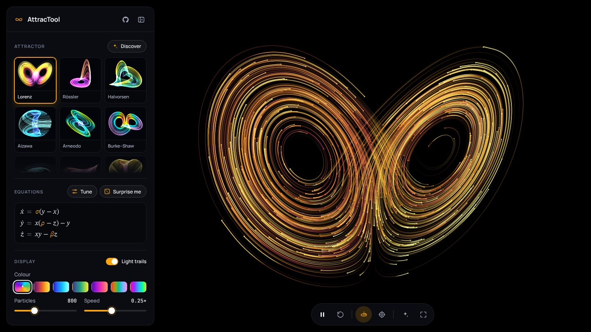

# AttracTool

Simulate chaotic attractors in 3D and explore how their parameters shape the dynamics.

**[Open AttracTool →](https://simonsmida.github.io/vin-attractool/)**



- Eleven classic systems, from Lorenz and Rössler to Aizawa and the three-scroll attractor
- **Discover** searches random quadratic flows for new chaotic attractors
- Tap the attractor to release a stream of nearby starts and watch the butterfly effect
- Particles brighten where the flow stretches fastest (local Lyapunov exponent)

Drag to rotate, scroll or pinch to zoom, right-drag or three fingers to pan, double-click to reset.

## Run locally

A static page with no build step or dependencies:

```sh
python3 -m http.server
```

Then open http://localhost:8000.

```
index.html      page and controls
assets/         script.js (simulation and WebGL renderer), style.css, icons
docs/           README images
```

[MIT License](LICENSE)
